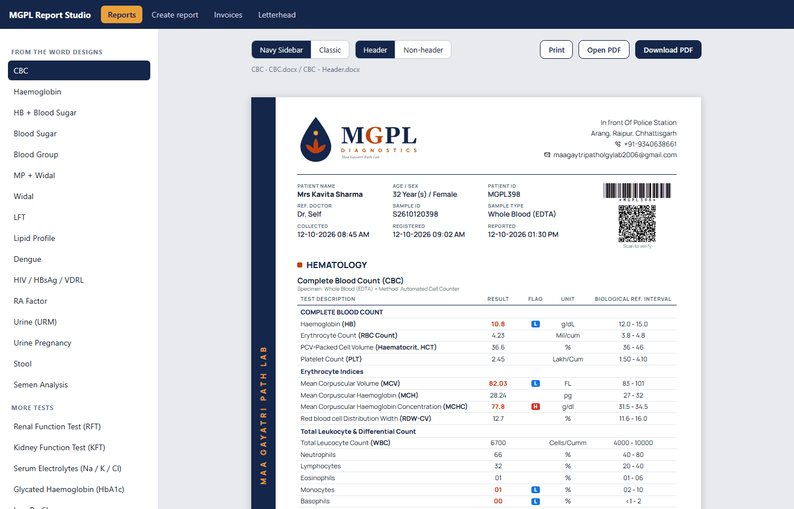
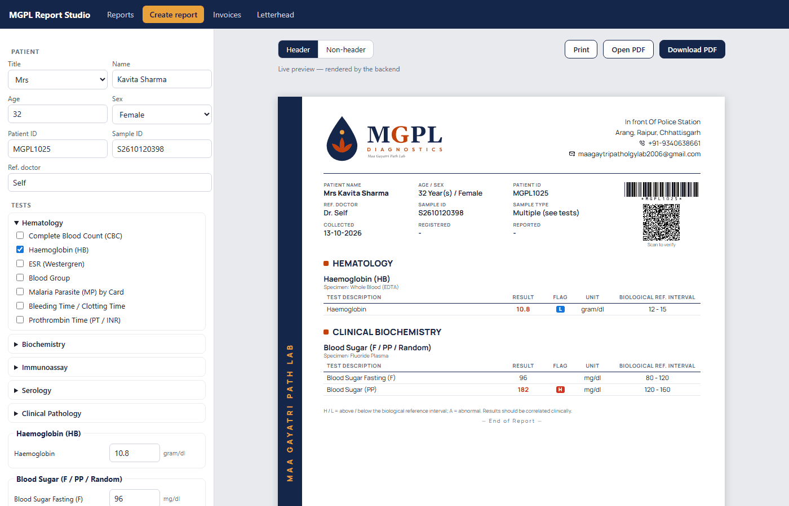
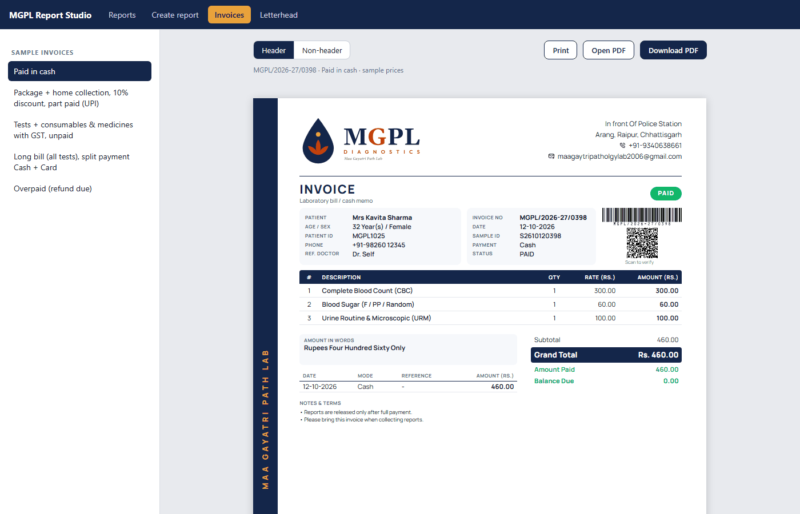

<div align="center">


# report-studio

**The reference app: a Next.js frontend on the MGPL client SDK, with the kits as its backend.**

Copy its patterns into any MGPL app: one backend route, a fully custom UI, live previews, PDF download.

[](#)
[](#)
[](#)
[](LICENSE)

</div>

---

<table>
<tr>
<td width="50%"></td>
<td width="50%"></td>
</tr>
<tr>
<td align="center"><b>Reports</b><br/><sub>39 samples · Navy Sidebar / Classic · Header / Non-header</sub></td>
<td align="center"><b>Create report</b><br/><sub>form built from <code>GET /templates</code>, live backend preview</sub></td>
</tr>
<tr>
<td width="50%"></td>
<td width="50%" valign="top">

### The split, in one picture

```
src/app/api/mgpl/[...path]/route.ts   ← BACKEND (the only kit import)
src/app/**/page.tsx                    ← FRONTEND (client SDK only)
src/lib/mgpl.ts                        ← createMgplClient()
```

`next build` makes every page **static**; only `/api/mgpl/*` runs on the server. Point
`NEXT_PUBLIC_MGPL_API` at another origin and the frontend deploys on its own.
</td>
</tr>
</table>

## Pages and routes

| Path | What |
|---|---|
| `/` | report gallery: design + variant toggles, print, open/download PDF |
| `/new` | **create a report**: patient + tests form generated from the catalog, live preview (`/new?demo` prefills) |
| `/invoice` | sample invoices |
| `/letterhead` | blank stationery (print borderless) |
| `/designs/index.html` | the six design options the Navy Sidebar was chosen from |
| `/api/mgpl/*` | the backend: `createMgplApi()` from invoice-kit (reports + invoices + assets) |

## Run it

```bash
npm install
npm run dev            # http://localhost:3000
```

The kits come from GitHub Packages. Add `.npmrc` (`@mgpl-diagnostics:registry=https://npm.pkg.github.com`) and a
token with `read:packages`. Inside the local MGPL workspace they are linked from the sibling folders instead.

### Environment

| Variable | Side | Purpose |
|---|---|---|
| `MGPL_SIGNATURE_HEADER_FILE` / `MGPL_SIGNATURE_NONHEADER_FILE` | backend | path to the **real signature images**. Keep them outside git; the repo only ships a placeholder. |
| `NEXT_PUBLIC_MGPL_API` | frontend | backend URL if it runs elsewhere (default `/api/mgpl`) |

Put them in `.env.local` (git-ignored).

## Use these patterns in your own app

1. **Backend:** copy [`src/app/api/mgpl/[...path]/route.ts`](src/app/api/mgpl/%5B...path%5D/route.ts), or mount the
   [Fastify plugin](https://github.com/mgpl-diagnostics/report-kit#mount-it-anywhere) in a separate server.
2. **Frontend:** `npm i @mgpl-diagnostics/client`, create one client ([`src/lib/mgpl.ts`](src/lib/mgpl.ts)) and build your UI.
   [`src/app/new/page.tsx`](src/app/new/page.tsx) shows a complete form → preview → PDF flow.
3. **Types:** [`src/contract-check.ts`](src/contract-check.ts) fails `npm run typecheck` if the client and the kits ever disagree.

## Scripts

`dev` · `build` · `start` · `typecheck` · `designs` (regenerates `public/designs/`)

See [AGENTS.md](AGENTS.md) for the rules (no rendering logic here; fix it in the kits).

## Part of MGPL Diagnostics

| Repo | Side | |
|---|---|---|
| [report-kit](https://github.com/mgpl-diagnostics/report-kit) | backend | reports, letterhead, templates |
| [invoice-kit](https://github.com/mgpl-diagnostics/invoice-kit) | backend | patient invoices + combined API |
| [client](https://github.com/mgpl-diagnostics/client) | frontend | headless SDK, zero dependencies |
| **report-studio** | app | Next.js reference app |

<sub>© MGPL Diagnostics (Maa Gayatri Path Lab). All rights reserved; see [LICENSE](LICENSE). All patients shown are fictional.</sub>
